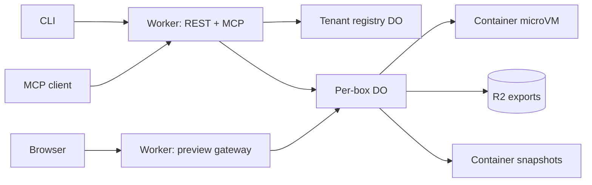

# CloudflareBoxes: compatibility research and design

Research date: 2026-11-01. Reference: [cloud-sandbox-vm-skills](https://github.com/ariana-dot-dev/cloud-sandbox-vm-skills), commit `95ab83b306c9313139409ad16aec7e1ccb0d57f5`, cloned under `reference/`. The repository describes Box by ASCII, not an implementation of its CLI or MCP server. Its prose is evidence of intended workflows, not proof of the current production contract. The project's API documentation redirects to boat.dev, but was inaccessible during this research. Do not claim wire compatibility without observing the actual service.

## Reconstructed surface

| Observed interface | Evidence | Behavior established by the skills | Unknowns |
|---|---|---|---|
| `box login "$BOX_API_KEY" --json` | [README](../reference/cloud-sandbox-vm-skills/README.md) | Authenticate non-interactively | credential storage, output, errors |
| `box new [--no-auto-stop] --json` | [cloud-vm](../reference/cloud-sandbox-vm-skills/skills/cloud-vm/SKILL.md), [background-worker](../reference/cloud-sandbox-vm-skills/skills/background-worker/SKILL.md) | Creates a machine; JSON stream has an object with `event: "ready"` and `id`. Default auto-stop described as one hour. | remaining events, input options, precise TTL semantics |
| `box info ID --json`, `box stop ID --json`, `box resume ID --json`, `box delete ID --json` | [cloud-vm](../reference/cloud-sandbox-vm-skills/skills/cloud-vm/SKILL.md), [cloud-sandbox](../reference/cloud-sandbox-vm-skills/skills/cloud-sandbox/SKILL.md) | info includes connection details; stop saves disk, resume restores it, delete cleans up | exact response schema, idempotency, failure states, deletion retention |
| `box fork ID --json` | [parallel-agents](../reference/cloud-sandbox-vm-skills/skills/parallel-agents/SKILL.md) | independent disk-level clone; ready event has ID; no process memory | consistency, snapshot lifecycle, live-write behavior |
| `box extend ID --hours N`, `--ttl SECONDS`, and `--no-auto-stop` | [cloud-vm](../reference/cloud-sandbox-vm-skills/skills/cloud-vm/SKILL.md), [background-worker](../reference/cloud-sandbox-vm-skills/skills/background-worker/SKILL.md), [tunnel](../reference/cloud-sandbox-vm-skills/skills/expose-localhost-tunnel/SKILL.md) | modify lifetime; recipes describe up to 30 days per extension | relative vs absolute deadline, combination rules, `--json` support |
| `box ssh ID [-- COMMAND...]` | [code-execution](../reference/cloud-sandbox-vm-skills/skills/code-execution/SKILL.md), [linux-server-ssh](../reference/cloud-sandbox-vm-skills/skills/linux-server-ssh/SKILL.md) | interactive SSH and remote execution, stdin/stdout redirection; CLI handles SSH key | quoting, TTY and signal semantics, exit codes, SCP syntax |
| `box prompt ID TEXT --json`, `box desktop ID --json` | [agent-sandbox](../reference/cloud-sandbox-vm-skills/skills/agent-sandbox/SKILL.md), [computer use](../reference/cloud-sandbox-vm-skills/skills/computer-use-browser-desktop/SKILL.md) | launch an agent; request desktop stream details | schemas, provider settings, recording and session lifecycle |
| In-guest `host PORT [--title TEXT] [--public\|--private]`, `host url PORT`, `host list`, `host hide PORT` | [tunnel](../reference/cloud-sandbox-vm-skills/skills/expose-localhost-tunnel/SKILL.md), [hosting](../reference/cloud-sandbox-vm-skills/skills/public-url-hosting/SKILL.md) | HTTPS routing; private token by default, public opt-in; revoke | output schema, token exchange, hostname lifetime |
| MCP | all skills | No MCP endpoint, tool names, schemas, or transport are described. | Entire upstream MCP contract; an MCP documentation server should not be assumed to be a sandbox control server. |

The public [Box site](https://box.ascii.dev/) additionally names `box list` and SCP, but does not specify their machine-readable contract. Skills include claims about pricing and limits that may be stale. This design does not rely on them.

## Recommended architecture

Use Workers Paid with a Worker as authenticated control plane and MCP Streamable HTTP endpoint, and a per-sandbox Durable Object (DO) controlling a Cloudflare Container using the **1.0** container API. Each instance is a Linux microVM running a pinned, curated container image, not a persistent VM. A tenant registry in a separate per-tenant DO tracks owned box IDs, quotas and operation records; each sandbox DO owns its state, snapshots, alarms and execution serialization. Store artifacts/long-term exports in tenant-scoped R2. Route HTTP previews through the Worker to the instance port after authorization. Use the same service methods for REST, MCP, and CLI so their behavior does not diverge.

Cloudflare's [sandbox overview](https://developers.cloudflare.com/sandbox/) and [1.0 release](https://developers.cloudflare.com/changelog/post/2026-09-30-sandbox-sdk-1-0/) describe this model. `@cloudflare/sandbox` 1.0 supplies optional helpers; it no longer supplies the lifecycle DO. Pin the package and matching shim image version as described in its [reference](https://developers.cloudflare.com/sandbox/reference/). Confirm account availability, instance sizes, quotas, and deployed-version APIs before implementation.

### State and concurrency

Persist `{tenantId, boxId, generation, state, image, snapshotId, deadline, idlePolicy, lastActivity, previewRoutes}` and operation IDs. States: `creating → running → stopping → stopped → starting → running`, with `deleting → deleted` and an error/reconciliation path. Distinguish desired state from observed container state: an instance can disappear without a callback. A per-box exclusive gate must serialize start, stop, fork, delete and every disk-mutating operation against snapshots. Long-running commands need leases tracked by the DO; reject or explicitly cancel them before stop/fork, and quiesce application writers where possible. Locking API calls cannot freeze background processes: a snapshot of a live writer is crash-consistent at best. Never claim transaction consistency without guest cooperation.

For stop, quiesce, snapshot writable root, persist snapshot ID before destroying the instance, then report stopped. If snapshot fails, do not destroy or report success. Resume starts from the recorded snapshot; process memory and running jobs do not return. Fork snapshots the parent under the same gate and initializes a new same-tenant DO with that snapshot; allocate a distinct box ID and start a fresh instance. Mounted R2 data is excluded from snapshots: define a separate copy policy or disallow mounts on fork. Delete revokes previews, stops the instance, deletes application metadata and R2 exports according to retention policy. The platform snapshot API currently has no immediate deletion method; record that physical snapshot expiry is not immediate and avoid promising secure erasure. [Snapshot documentation](https://developers.cloudflare.com/sandbox/files/save-and-restore-a-workspace/) and [automatic save](https://developers.cloudflare.com/sandbox/files/save-a-sandbox-automatically/) document these limits.

Snapshots are limited to 20 GB under the documented platform limits and expire 30 days after creation or last restore; export durable data to R2 for longer retention. Checkpoint periodically as well as on explicit stop: an unexpected termination can lose all changes since the last successful checkpoint. A scheduled alarm handles idle stop, hard TTL and checkpoints. Reset the inactivity timeout in the DO constructor; it has a six-hour maximum, and guest execution alone does not keep the DO active. Alarms/active requests can keep a long job alive but do not guarantee uninterrupted 24/7 service. See [lifetime](https://developers.cloudflare.com/sandbox/concepts/lifetime/). Make restart behavior and recovery point visible to clients.

### Proposed API (new contract, not observed upstream)

All routes require a tenant-scoped bearer credential, use `application/json` unless streaming, and return `{error:{code,message,request_id}}` on failure. A client-generated `Idempotency-Key` on creation/fork and lifecycle mutations maps to a stored operation and request hash; reject key reuse with different input. Commands are not automatically retried. The container exec API has no built-in hard timeout: implement a guest-side process-group supervisor, confirm child termination, and report an unknown outcome when cancellation cannot be confirmed. A client disconnect alone must not be treated as cancellation. IDs are opaque lowercase random identifiers, resolved under the authenticated tenant, never directly from untrusted DO names. Responses return operation IDs for asynchronous work; `GET /v1/operations/:id` reports `pending|running|succeeded|failed` with result/error. Use bounded timeouts, output limits and explicit truncation flags.

| Route | Request / result |
|---|---|
| `POST /v1/boxes` | `{image?, idle_seconds?, expires_at?, no_auto_stop?}` → operation; result `{id,state}` |
| `GET /v1/boxes`, `GET /v1/boxes/:id` | tenant-scoped list / `{id,state,image,deadline,last_checkpoint_at,capabilities}` |
| `POST /v1/boxes/:id/stop`, `/resume`, `/fork` | operation; fork result includes new `id` |
| `PATCH /v1/boxes/:id` | update deadline/idle policy; validate TTL, distinguish idle from hard expiry |
| `DELETE /v1/boxes/:id` | operation, idempotent tombstone |
| `POST /v1/boxes/:id/commands` | `{argv, cwd?, env?, timeout_ms?, stdin?}` → `{exit_code,stdout,stderr,truncated}` or stream; shell explicitly via `["/bin/sh","-lc",script]` |
| `POST /v1/boxes/:id/terminals` | authenticated WebSocket terminal with input/output, resize, exit and disconnect events |
| `GET/PUT /v1/boxes/:id/files` | bounded streaming transfer with path; guest filesystem is shared with commands |
| `POST /v1/boxes/:id/previews`, `GET .../previews`, `DELETE .../previews/:port` | create/list/revoke `{port,title?,visibility}`; private default |

MCP tools are **proposed**, not reverse-engineered upstream names: `box_create`, `box_list`, `box_info`, `box_stop`, `box_resume`, `box_fork`, `box_delete`, `box_extend`, `box_exec`, `box_read_file`, `box_write_file`, `box_preview_create`, `box_preview_list`, `box_preview_delete`. Define JSON Schema input and structured output from the REST contract during implementation, plus a capability endpoint. MCP should return explicit tool errors and bounded output; interactive terminal and binary streams remain HTTP/WebSocket operations. Authenticate and authorize every tool invocation, validate Origin for browser requests, and follow the current [MCP transport specification](https://modelcontextprotocol.io/specification/2025-11-25/basic/transports). Support protocol negotiation and session behavior via a maintained MCP SDK rather than hand-rolling it.

A new `cfbox` CLI can map `new`, `info`, `list`, `stop`, `resume`, `fork`, `delete`, `extend`, `exec`, `terminal`, and `preview` to these APIs. Emit NDJSON for progress and `{event:"ready",id}` on successful `new`/`fork`, preserving the demonstrated jq recipe. Write diagnostics to stderr; return nonzero for command failures and propagate remote exit codes where possible. Add an explicitly named compatibility shim only after checking the real CLI: `box ssh` implies actual SSH, while an exec or WebSocket terminal is not SSH/SCP. In-guest `host` requires a deliberately scoped guest-to-control-plane bridge, with per-box short-lived credentials and no control-plane admin secret in the guest; otherwise use `cfbox preview` from the client.

### Preview security and execution isolation

Use a separate wildcard preview domain and an opaque route identifier, bind it to tenant/box/port in the registry, and reject unknown/deleted routes. Private previews require an expiring scoped token exchanged for an HttpOnly, Secure, SameSite cookie; validate access on every request and WebSocket upgrade. Never rely on an unguessable URL as authorization. Public previews must be an explicit opt-in. Strip internal authorization headers before proxying; prevent preview origins from receiving control-plane cookies. Revocation removes the registry entry and closes or limits existing sessions. Use Cloudflare's current sandbox preview documentation for the proxy API.

Separate tenants and mutually untrusted jobs into different sandboxes. Default outbound Internet to disabled; permit only selected destinations through the platform's outbound controls when required. Do not inject account-wide credentials or platform API keys into a sandbox. Enforce per-tenant concurrent box, CPU/time, disk, output and request limits; audit lifecycle and access without recording secrets or command contents by default. Restrict images and instance size to an administrator-approved allowlist. A sandbox can access anything inside its own filesystem, environment and network permissions; isolation is not a promise of zero risk.

### Parity boundaries

- **SSH/SCP:** Cloudflare now supports Wrangler SSH and its OpenSSH ProxyCommand, subject to Cloudflare account permissions, authorized keys, and a running instance. Dedicated IP and inbound raw TCP/UDP are not provided. See the current README for details.
- **Docker/compose:** the repository expects Docker inside the machine. Validate current Cloudflare nested-container support and privilege constraints with a prototype before claiming it; do not expose privileged host access.
- **Desktop/Lux, prompt harness:** custom image and services could be explored, but streaming desktop, browser automation, recordings and agent credentials are not designed as MVP parity. Return explicit unsupported capability, never a fabricated desktop URL.
- **Always-on:** alarm-based activity is a best-effort runtime policy, not uninterrupted VM hosting. In-flight processes are lost on stop. Provide health/restart semantics or use a different hosting product for strict availability.
- **Disk:** snapshots exclude mounts, `/run`, memory and processes; expire and can be inconsistent with active writes. They are public beta. Snapshot capacity, performance, costs, and region guarantees require verification.
- **Sizes, toolchains, pricing:** choose supported Cloudflare sizes and build a pinned image; do not promise Box's 4 vCPU / 8 GB / 80 GB, installed tools, location, or pricing without measurement.

## Delivery and validation

1. Obtain the upstream CLI/API/MCP source or authenticated read-only `--help`, MCP `tools/list`, and sanitized captures of success, errors, streaming, TTY and signals. Version fixtures and document differences before promising compatibility.
2. Prototype one DO and container: create, exec with stdin/output/exit, checkpoint, stop, resume, fork, kill/recovery. Test live writers, concurrent calls, failed snapshots, expiration, snapshot inheritance and cost; verify actual account limits.
3. Implement tenant registry, lifecycle operations, idempotency, auth, quotas and cleanup; integration-test cross-tenant denial and failures at each persist/destroy boundary.
4. Add scoped file transfer and private preview gateway; test token expiry, revocation, WebSockets, hostile origins and header isolation. Add MCP and CLI against the same service contract.
5. Add images and agent integration, then evaluate Docker and desktop independently. Publish a compatibility matrix with measured behavior and unsupported commands.
